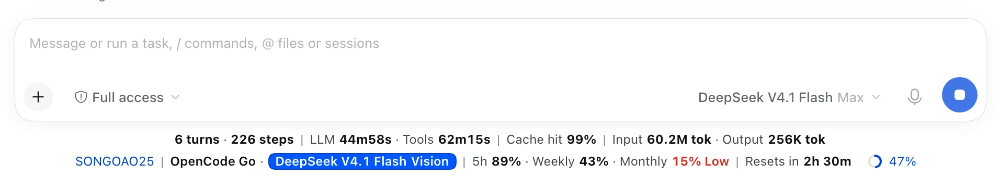
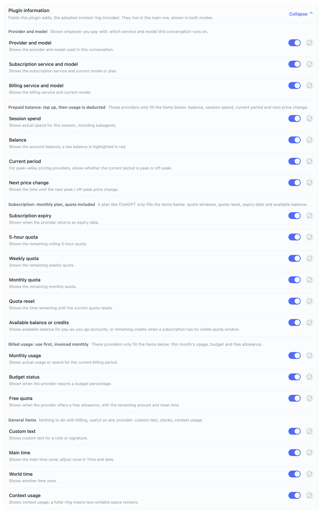
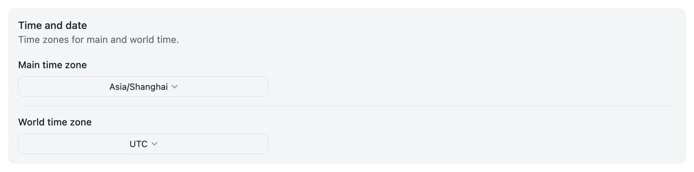

# Bottom Info Bar

**English** | [**中文**](README.zh-CN.md)

[](https://www.npmjs.com/package/dsh-bottom-info-bar)
[](https://github.com/songoao25/dsh-bottom-info-bar/blob/main/LICENSE)

A DeepSeek Harness plugin that adds an account information row under the composer: provider and model, real balance or subscription quota, peak/off-peak pricing, and what this session has cost.



## What it shows

The bar follows the active session and picks one of three readings per provider (mutually exclusive, nothing to switch by hand): **balance** shows the real balance from the provider's own API, **subscription quota** shows each quota window's remaining allowance with its reset countdown, and **cloud billing** shows this month's real spend from the official billing API. On top of that come four spend tallies — this session, today, last 30 days, all time — plus extras such as time and custom text. All four come from the plugin's own ledger, which **starts counting when the plugin first runs**: calls made before that (or before you cleared the ledger) are not included, and hovering the spend writes out the exact start of the count. For the authoritative figure for a whole session, use the provider's own balance or bill. In balance mode, hovering the balance expands it into topped-up and granted balances, so gifted credit is never conflated with the money you paid in.

On **DSH 0.2.1-rc.1 with the native activity/usage buttons**, the native line sits on top and the plugin's account information on the line below. Clicking any plugin field still switches between **Full** and **Compact** with the same height/fade animation: Full shows the native line, Compact collapses it. The native buttons keep their own click behavior and open Harness's details dialogs. Each of the two native buttons can be hidden separately from the plugin's settings page. The context ring keeps its existing details and plugin settings.

On **older hosts**, clicking the bar still switches between **Full** and **Compact**: Full keeps the legacy statistics row, Compact collapses it. Plugin fields remain identical in both modes. Compatibility is detected from the host's live extension entries, rather than a version string.

## Install

Recommended: open the DSH plugin page, choose **Add plugin**, and enter the npm package name — DSH fetches the published package from npm, with no commands and no build:

```
dsh-bottom-info-bar
```

Prefer the terminal? The same install from the command line:

```bash
dsh plugin --profile web add dsh-bottom-info-bar
```

To run the newest code from the default branch instead of the latest release, paste the repository URL into the same field:

```
https://github.com/songoao25/dsh-bottom-info-bar
```

Then **restart DSH** — plugins are composed when the host starts, so a page refresh is not enough. In the desktop app, use **Plugins → Add plugin**; its profile is managed by the app and cannot be installed into through the CLI. Other install methods (including Windows PowerShell) and troubleshooting: [docs/INSTALL.md](docs/INSTALL.md).

The context usage ring keeps the native hover tooltip and opens a statistics panel when clicked. Both overlays render outside the bottom bar so they do not change its contents.

## Settings

Plugin settings live under **Plugins → bottom-info-bar** and save as you change them. **Plugin information** and **notices** keep their field switches and colors. On modern hosts, **native information** offers one switch per native button (session stats / usage) so either entry can be hidden; the obsolete per-field statistics-row controls are omitted from the page, search results and enabled counts. Their saved values are retained for older hosts. Older hosts still show the native field controls. Resetting plugin fields or colors does not change Harness's native button preferences.



Plugin information is further grouped by billing mode — read only the block that matches your provider; each block's heading says which items carry data for it. Time zones, custom text, quota percentage direction and billing data are separate sections:



API keys go in DSH under **Settings → Models**; subscriptions (Codex, OpenCode, Xiaomi Token Plan, Command Code, MiniMax) read the local sign-in, and MiniMax requires a Subscription Key. Anything off the list gets a not-supported hint instead of borrowed numbers.

## Spend and updates

The ledger requires a DSH runtime with Node.js 22.13 or newer. It keeps records and historical session indexes in a local disk database, reads bounded batches, and streams exports. Existing ledger files are migrated once and retained for recovery; see [Ledger storage and recovery](docs/LEDGER.md).

Every model response records one entry (usage × unit price, locked the moment the response completes) and survives restarts. The plugin checks npm once per DSH start: **automatic updates** (default) download in the background and take effect after you restart, **manual updates** only notify; a bad release can be rolled back from settings. The ledger stores tokens and amounts, never conversation content; data stays under this end's `DSH_HOME` in `dsh-bottom-info-bar/` (default `~/.dsh/dsh-bottom-info-bar/`, overridable via `DSH_BOTTOM_INFO_BAR_DATA_DIR`) and survives uninstall — export or clear it from Billing data if you want a clean slate.

## Uninstall and roll back

Remove the plugin on the DSH plugin page (or `dsh plugin --profile web remove dsh-bottom-info-bar`) and restart DSH: the native stats row comes back by itself and no plugin files are left behind. The ledger is kept on purpose — export or clear it from **Billing data** before removing the plugin if you want a clean slate. To go back a version instead, the update section offers **roll back to the previous version** while a newer build is waiting for a restart, and after a failed update. Details: [docs/INSTALL.md](docs/INSTALL.md).

## Languages

The plugin includes English, Simplified and Traditional Chinese, Japanese, Korean, Spanish, Portuguese, French, German, Italian, Russian, Hindi and Indonesian. It follows DSH’s language by default. Choose **Language** on this plugin’s settings page to use a different language independently; the choice is saved in this browser. Regional variants such as Spanish (Mexico) and Portuguese (Brazil) use the corresponding built-in language. Unsupported languages fall back to English.

## Development

- Build: `npm run build`
- Test: `node tests/run-all.mjs`
- Contributing: [CONTRIBUTING.md](CONTRIBUTING.md)

## License

[MIT](LICENSE) © 2026 songoao25

Questions or ideas? Join our WeChat group **DeepThinking** — [QR code](assets/wechat-group.png).

Holiday pricing includes the official 2026 Chinese holiday leave ranges. Later calendars must be updated after the annual State Council notice; unlisted years use the weekday/weekend rule. Make-up working weekends remain off-peak. Frozen historical costs are unchanged.
