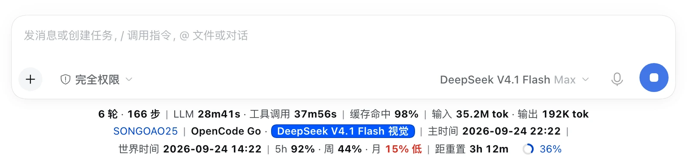
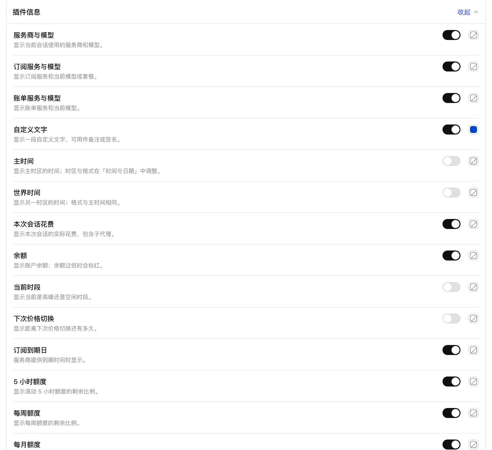
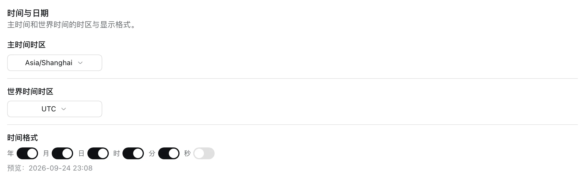

# 底部信息栏

[**English**](README.md) | **中文**

[](https://www.npmjs.com/package/dsh-bottom-info-bar)
[](https://github.com/songoao25/dsh-bottom-info-bar/blob/main/LICENSE)

### 加入内测群 DeepThinking


问题和需求群里反馈解决得最快——扫码进内测群，直接说遇到的问题或者想要的功能，我们会优先安排。二维码有有效期，扫不动了就在 issue 里说一声。

DeepSeek Harness 插件：把输入框下方那行统计栏换成一行信息栏——服务商与模型、真实余额或订阅额度、高峰/空闲定价，以及本会话已经花了多少。



## 它显示什么

信息栏跟随当前会话，按服务商自动选择三种口径之一（互斥，不用手动切）：**余额制**显示官方接口的真实余额，**订阅制**显示各额度窗口剩余额度与重置倒计时（额度用尽时窗口仍显示 0%，不会从信息栏消失，并标红提示「低」），**云账单制**显示官方账单接口的本月真实花费。之外还有本会话/今天/近 30 天/累计四档花费，以及时间、自定义文字等通用项。这四档都来自插件自己的账本，**从插件开始运行那一刻起记账**：装上之前（或清除账单之后）已经发生的调用不在其中，把鼠标停在花费上会写明统计起点；要整场会话的权威数字，请以服务商的余额或账单为准。余额制下把鼠标停在余额上，会展开「充值余额 / 赠金余额」两行明细，赠送的那部分不再是糊涂账。

**DSH 0.2.1-rc.1 提供新版原生统计按钮时**，原生那一行在上、插件账户信息在下。点击插件信息行的任意字段仍可切换**完整/简洁**，保留原来的高度收合与淡出动画：完整显示原生行，简洁把它收起。原生两个按钮保留自己的点击行为，点开是 Harness 的明细弹窗；也可以在插件设置页分别隐藏这两个原生按钮。上下文圆环继续保留现有明细和插件设置。

**旧宿主**仍保留点击信息栏切换**完整/简洁**：完整显示旧统计行，简洁收起它；插件字段在两种模式下一致。兼容方式通过实际扩展入口判断，不依赖版本号猜测。

## 安装

最推荐：打开 DSH 的插件页 → **添加插件**，在「包名或地址」里填 npm 包名——DSH 会直接从 npm 下载已发布的版本，不用敲命令，也不用构建：

```
dsh-bottom-info-bar
```

习惯用终端？命令行装的是同一个包：

```bash
dsh plugin --profile web add dsh-bottom-info-bar
```

想跑默认分支上的最新代码而不是已发布的版本，就在同一个输入框里填仓库地址：

```
https://github.com/songoao25/dsh-bottom-info-bar
```

然后**重启 DSH**（插件在宿主启动时组合，只刷新页面不够）。桌面客户端请使用**插件 → 添加插件**；它的配置由客户端管理，不能通过命令行安装。其他装法（含 Windows PowerShell）与排障见 [docs/INSTALL.md](docs/INSTALL.md)。

上下文占用圆环保留原生悬浮提示，点击可打开统计面板。提示和面板都显示在底栏外层，避免出现时改动底栏内部。

## 设置

插件设置都在**插件 → bottom-info-bar**，改完自动保存。**插件信息**和**提醒信息**保留各自的开关与配色。新版的**原生信息**为两个原生按钮各提供一个开关（会话统计 / 用量统计），可以分别隐藏；旧统计行的逐字段控件不再显示，也不计入搜索结果和启用数量，旧设置仍保留供旧宿主使用。旧宿主继续显示原生字段控件。重置插件字段或颜色不会改动 Harness 原生按钮的偏好。



「插件信息」里再按计费方式分块——你用哪种服务，就只看哪一块，哪几项有数据的说明写在块标题旁。时区、自定义文字、订阅窗口方向、账单数据是独立设置区：



密钥填在 DSH 的**设置 → 模型**；订阅类（Codex、OpenCode、小米 Token Plan、Command Code、MiniMax）读本机登录，MiniMax 必须用 Subscription Key。列表里没有的服务商只会显示未适配提示，绝不借用别家的数据。

## 花费与更新

账本需要 DSH 内部运行环境为 Node.js 22.13 或更新版本。账目和历史会话保存在本机磁盘，按需分批读取，导出直接下载。升级会迁移旧账，但保留旧文件供恢复核对；详见 [账本存储与恢复](docs/LEDGER.md)。

每次模型响应记一条（用量 × 单价，单价在响应完成时锁定），重启不丢。插件每次随 DSH 启动检查一次新版本：**全自动更新**（默认）下载好等你重启生效，**手动更新**只提示不下载；新版有问题可以在设置页回滚到上一版。账本只记 token 与金额，不记对话内容；数据存放在本端 `DSH_HOME` 下的 `dsh-bottom-info-bar/` 目录（默认 `~/.dsh/dsh-bottom-info-bar/`，可用 `DSH_BOTTOM_INFO_BAR_DATA_DIR` 覆盖），卸载不删——要清零去设置页的账单数据里导出或清除。

## 卸载与回退

在 DSH 插件页移除（或 `dsh plugin --profile web remove dsh-bottom-info-bar`）后**重启 DSH**：原生统计栏会自动恢复，插件代码不留残留。账本是有意保留的——想彻底清零，先在设置页「账单数据」里导出或清除，再卸载。只想退回上一版的话，在有新版本等待重启时、以及更新失败后，设置页的更新区会给出**回滚到上一版**。细节见 [docs/INSTALL.md](docs/INSTALL.md)。

## 语言

插件内置简体中文、繁体中文、英语、日语、韩语、西班牙语、葡萄牙语、法语、德语、意大利语、俄语、印地语和印度尼西亚语。默认跟随 DSH 的语言；也可以在本插件设置页的**语言**中单独选择，选择会保存在当前浏览器。墨西哥西班牙语、巴西葡萄牙语等地区变体使用对应的内置语言；不支持的语言显示英语。

## 开发

- 构建：`npm run build`
- 测试：`node tests/run-all.mjs`
- 贡献：[CONTRIBUTING.md](CONTRIBUTING.md)

## 许可证

[MIT](LICENSE) © 2026 songoao25

节假日计价已覆盖国务院公布的 2026 年中国放假调休日期。后续年份需在年度通知公布后更新日历；未收录年份使用周一至周五/周末规则。调休上班的周末仍为空闲价，已冻结的历史费用保持不变。
